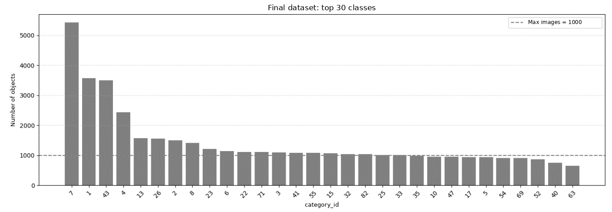
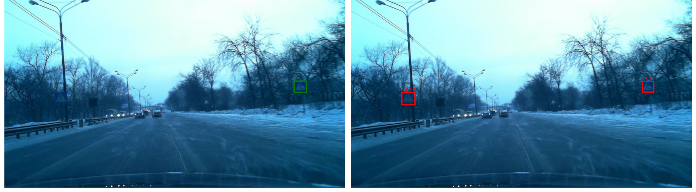
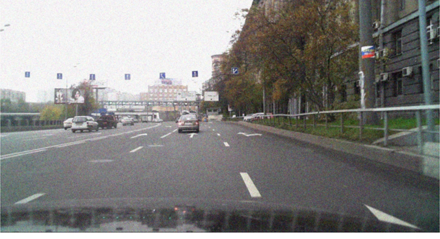
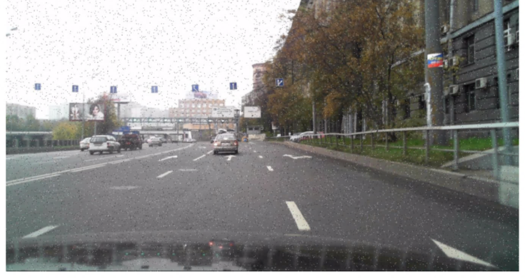
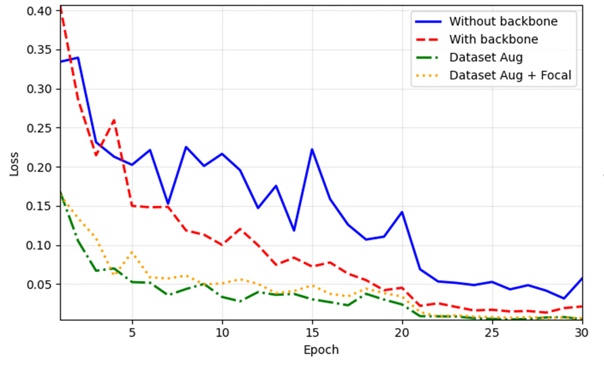
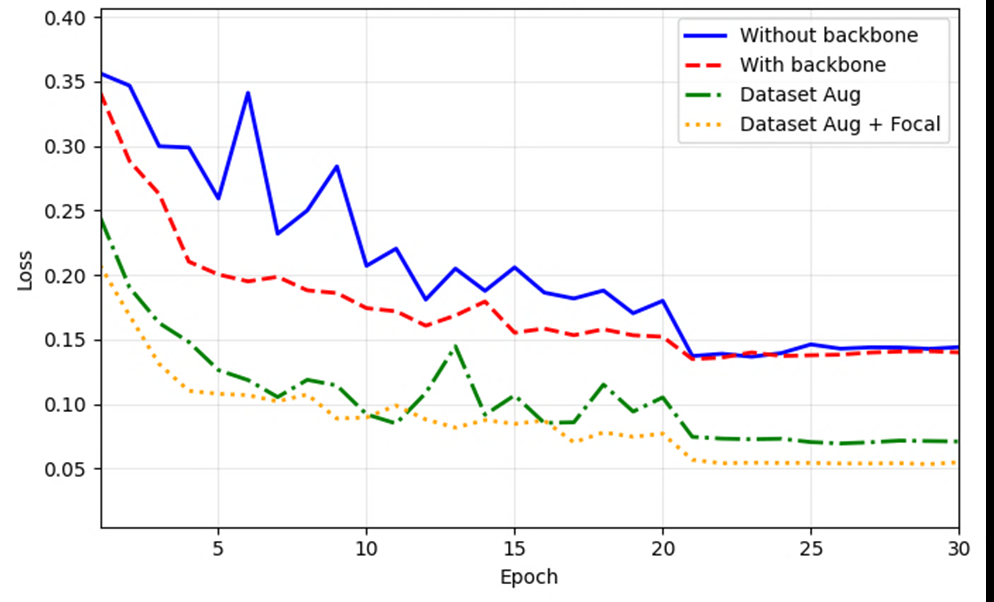

# Traffic Sign Detection and Classification: Faster R-CNN vs YOLOv8

**An experimental study of detector architectures, training strategies, annotation quality, and robustness to image noise.**

Bachelor's research in Applied Mathematics and Informatics, Novosibirsk State Technical University (2026).  
**Author:** Tamila R. Minvaliyeva  
**Research supervisor:** I. M. Stupakov

## Overview

Traffic sign detectors must handle small objects, uneven class frequencies, changing image quality, and incomplete annotations. This project investigates how training decisions and model design affect traffic sign detection and classification.

The study has two parts:

1. **GTSDB preliminary experiments:** evaluate pretraining, augmentation-based class balancing, and Focal Loss with Faster R-CNN.
2. **RTSD main experiments:** compare a standard Faster R-CNN, a modified Faster R-CNN with a ResNet50–FPN backbone, and three YOLOv8 variants (nano, medium, large). Evaluate accuracy, training and inference time, annotation corrections, and robustness to synthetic noise.

The project reports **AP at IoU = 0.50**, averaged over classes (referred to below as **mAP@0.5**). Scores refer to this metric unless otherwise specified; they are **not** COCO mAP@[0.50:0.95].

## Datasets

| Dataset | Role | Configuration |
|---|---|---|
| **[GTSDB](https://doi.org/10.1109/IJCNN.2013.6706807)** — German Traffic Sign Detection Benchmark | Preliminary study of class imbalance and training methods | 900 images, 43 traffic sign classes |
| **[RTSD](https://graphics.cs.msu.ru/projects/traffic-sign-recognition.html)** — Russian Traffic Sign Dataset | Main architecture comparison | 30 most frequent classes selected from the dataset's 155 classes |

For RTSD, the filtering procedure limited classes with more than 1,000 images to a maximum of 1,000 selected images per class. Since a frame may contain multiple signs, **object counts are not capped at 1,000**. Filtered images were split into **70% training, 15% validation, and 15% testing**, using random seed **42**. The experiments compared models using the same split.



*Annotated-object distribution after RTSD class filtering. The dashed line represents the 1,000-image selection limit, not an object-count ceiling.*

## Models and methods

| Model | Implementation | Main characteristics |
|---|---|---|
| Faster R-CNN (baseline) | `torchvision` | ResNet50–FPN, COCO-pretrained detector, classification head adapted to 30 sign classes and background |
| Modified Faster R-CNN | `torchvision` | ResNet50–FPN; intended replacement of BatchNorm/FrozenBatchNorm with **GroupNorm** (up to 32 groups) and ReLU with **SiLU**; compatible COCO backbone weights loaded separately from the proposal and detection heads |
| YOLOv8 nano | Ultralytics | COCO-pretrained one-stage detector |
| YOLOv8 medium | Ultralytics | Larger one-stage detector |
| YOLOv8 large | Ultralytics | Largest YOLOv8 variant included in the comparison |

Both Faster R-CNN variants used SGD (learning rate **0.005**, momentum **0.9**, weight decay **0.0005**), batch size **2**, and **15 epochs**. The YOLOv8 experiments used image size **640**, batch size **8**, **15 epochs**, and configured initial learning rate **0.005**, momentum **0.9**, and weight decay **0.0005**; other training behavior followed the Ultralytics implementation.

The original experiments were performed on an **NVIDIA RTX 4000 SFF Ada Generation GPU**, Intel Core i7-14700 CPU, and **128 GB RAM**.

### Annotation audit

Model predictions exposed traffic signs visible in images but absent from the original RTSD labels. An automatic screening procedure used NMS and **IoU = 0.5** matching to flag potentially missing annotations. **1,206 images were flagged for manual review**; confirmed missing objects were added to the annotations. This number is the count of **flagged images**, not the number of corrections made.



*Example illustrating a discrepancy between dataset annotations and detector predictions.*

## Results

### RTSD: detection accuracy and training time

| Model | mAP@0.5 — original annotations | mAP@0.5 — corrected annotations | Training time (min) |
|:--|--:|--:|--:|
| Faster R-CNN | 0.8873 | 0.9059 | 775 |
| Modified Faster R-CNN | 0.9135 | 0.9461 | 523 |
| YOLOv8 nano | 0.8552 | 0.8758 | 55 |
| YOLOv8 medium | 0.9428 | 0.9730 | 77 |
| **YOLOv8 large** | **0.9465** | **0.9767** | 121 |

- **YOLOv8 large** achieved the highest reported accuracy on clean RTSD images.
- The modified Faster R-CNN achieved higher measured mAP@0.5 than the baseline (**0.9135 vs 0.8873**) and trained in **523 vs 775 minutes** (approximately **32.5% less time**).
- Correction of missing annotations increased the reported scores for **all five models**.

These results reflect individual reported runs, not averages across independent training seeds. The Faster R-CNN variants also differed in component initialization; the effect of GroupNorm cannot be separated from SiLU and initialization differences using these results alone.

### RTSD: robustness to synthetic noise

The following tests used the **corrected annotations**. Gaussian noise was applied with standard deviation **25** on the 0–255 intensity scale; salt-and-pepper noise was applied at probability **0.02**.

| Model | Gaussian noise mAP@0.5 | Salt-and-pepper noise mAP@0.5 |
|:--|--:|--:|
| Faster R-CNN | 0.6730 | 0.7900 |
| **Modified Faster R-CNN** | **0.9060** | 0.9000 |
| YOLOv8 nano | 0.7085 | 0.7895 |
| YOLOv8 medium | 0.7815 | 0.9244 |
| YOLOv8 large | 0.8626 | **0.9376** |

The modified Faster R-CNN had the highest reported accuracy under the tested **Gaussian noise**, whereas **YOLOv8 large** performed best under **salt-and-pepper noise**. These findings concern two synthetic corruptions at one intensity each; they do not establish robustness to real rain, fog, or night driving.

| Gaussian noise | Salt-and-pepper noise |
|:--:|:--:|
|  |  |

### RTSD: GPU inference time

| Model | Native PyTorch GPU inference (ms/image) |
|:--|--:|
| Faster R-CNN | 55.80 |
| Modified Faster R-CNN | 57.00 |
| YOLOv8 nano | 2.89 |
| YOLOv8 medium | 8.06 |
| YOLOv8 large | 12.65 |

These are **implementation-level measurements**. Faster R-CNN and YOLOv8 used different frameworks and execution paths, so the results should not be interpreted as a perfectly controlled architecture-only speed comparison. The study also measured an Ultralytics pipeline separately; those timings are not interchangeable with the native PyTorch figures above.

### GTSDB: preliminary class-imbalance study

Faster R-CNN experiments added training changes cumulatively:

| Configuration | AP@0.50 |
|:--|--:|
| Random initialization | 0.468 |
| Pretrained weights | 0.586 |
| Pretrained weights + class-balancing augmentation | 0.856 |
| Pretrained weights + augmentation + Focal Loss | **0.886** |

The class-balancing process used seven rain, fog, night, lens-flare, and combined-condition augmentations; the Focal Loss experiment used **γ = 2.0** and **α = 0.25**. Because the changes were added sequentially, this is **not an ablation study** that independently isolates each method's contribution.

| Training loss | Validation loss |
|:--:|:--:|
|  |  |

*Loss curves from the original GTSDB experiments.*

## Repository contents

```text
.
├── README.md
├── notebooks/
│   ├── faster_rcnn.ipynb       # Modified Faster R-CNN on RTSD
│   └── yolov8.ipynb            # YOLOv8 training/evaluation on RTSD
└── assets/
    ├── class_distribution.png
    ├── annotation_example.png
    ├── gaussian_noise.png
    ├── salt_and_pepper_noise.png
    ├── gtsdb_training_loss.png
    └── gtsdb_validation_loss.png
```

The included notebooks focus on the **RTSD** experiments. The GTSDB findings and figures are documented from the thesis; a separate GTSDB training notebook is **not included** in this package.

## Getting started

### 1. Install dependencies

Use a Python environment with compatible versions of PyTorch and torchvision, then install the notebook dependencies:

```bash
python -m pip install torch torchvision ultralytics pycocotools numpy pandas matplotlib pillow opencv-python pyyaml jupyter kaggle
```

Choose an appropriate PyTorch/CUDA installation for your hardware. A GPU is strongly recommended for model training.

### 2. Prepare RTSD

Download RTSD from its dataset provider and extract the annotations and image frames. The notebooks use a working-directory-relative layout similar to:

```text
rtsd_data/
├── train_anno.json
├── val_anno.json
├── label_map.json
└── rtsd-frames/
    └── rtsd-frames/
        └── <image files>
```

If your extracted folders are arranged differently, update `DATASET_ROOT` and `FRAMES_DIR` in the notebook. The YOLOv8 notebook also includes optional Kaggle download cells for the `watchman/rtsd-dataset` mirror, which require Kaggle access and credentials.

### 3. Open the notebooks

```bash
jupyter notebook
```

- [`notebooks/faster_rcnn.ipynb`](notebooks/faster_rcnn.ipynb) — build the modified backbone, filter/split RTSD data, train, and evaluate Faster R-CNN. Its detection evaluation relies on torchvision reference utilities (`engine.py`, `coco_eval.py`, `coco_utils.py`, `utils.py`), which the notebook downloads if not present.
- [`notebooks/yolov8.ipynb`](notebooks/yolov8.ipynb) — convert RTSD annotations into YOLO format, train a selected YOLOv8 size, and evaluate predictions. Change `MODEL_NAME` from `yolov8n.pt` to the desired variant when reproducing the medium or large configurations.

**Notebook notes:** some cells assume access to Google Colab, previously generated noisy-image folders, or a particular checkpoint path. Skip optional visualization/mount cells that do not apply to your environment and point evaluation cells to the checkpoint actually produced by training. For Faster R-CNN, training saves `best_model_rtsd.pth` while the supplied evaluation cell references `model_modernized.pth`; use the appropriate available filename. Ultralytics output directories can also vary by version and working directory.

## Reproducibility and limitations

- Reported experimental results are based on the original bachelor's thesis. Reproducibility with the current repository code has not been independently verified.
- Checkpoints and dataset files are not bundled in this package.
- RTSD results use a filtered 30-class subset instead of the official full-dataset benchmark; cross-paper comparisons need this qualification.
- Annotation corrections partly relied on model-proposed boxes and manual inspection, which can affect the corrected-label evaluation.
- Results are from single training runs; there are no confidence intervals from repeated independent seeds.
- Noise robustness was tested on synthetic Gaussian and salt-and-pepper noise at one intensity each.

## References

1. Houben, S. *et al.* (2013). [Detection of Traffic Signs in Real-World Images: The German Traffic Sign Detection Benchmark](https://doi.org/10.1109/IJCNN.2013.6706807). *IJCNN*.
2. Shakhuro, V. I., and Konushin, A. S. (2016). [Russian Traffic Sign Images Dataset](https://doi.org/10.18287/2412-6179-2016-40-2-294-300). *Computer Optics, 40*(2), 294–300.
3. Ren, S. *et al.* (2015). [Faster R-CNN: Towards Real-Time Object Detection with Region Proposal Networks](https://proceedings.neurips.cc/paper/2015/hash/14bfa6bb14875e45bba028a21ed38046-Abstract.html). *NeurIPS*.
4. Wu, Y., and He, K. (2018). [Group Normalization](https://doi.org/10.1007/978-3-030-01261-8_1). *ECCV*.
5. [Ultralytics YOLO documentation](https://docs.ultralytics.com/).

---

*Research results and figures: Tamila R. Minvaliyeva, bachelor's thesis, Novosibirsk State Technical University, 2026.*
